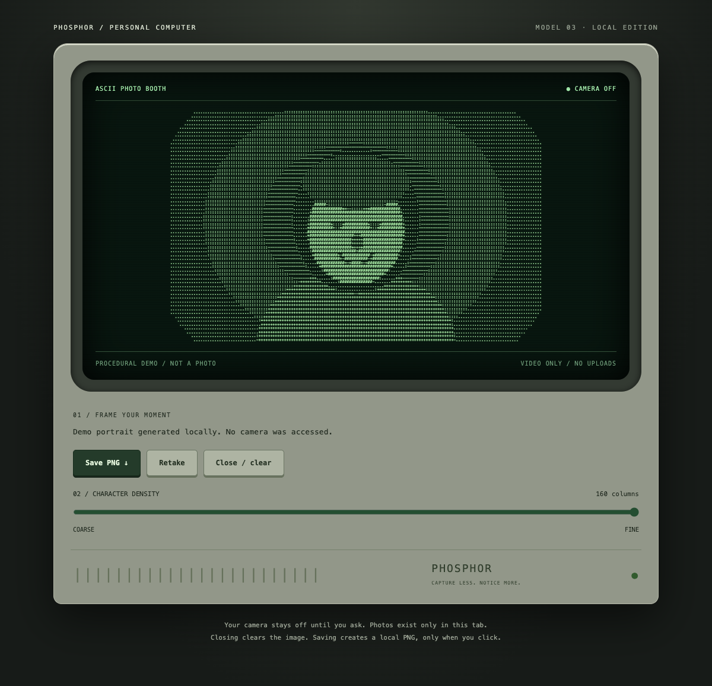

# ASCamera - FATQ

A retro, local-first ASCII camera made for **SD5913 Assignment 3: An interactive experience** at PolyU.

**Live:** https://sd5913.fatq.top

## Idea and intended user

For someone who wants a playful camera portrait without an account or uploading their image: turn on the camera, see yourself in live ASCII, adjust character density, then freeze and keep a moment.

## Use

- **Power** starts or stops the camera. Permission is video-only.
- **Take photo** also starts live preview when power is off. Once ready, press to freeze; press again to resume. Freezing keeps camera power on.
- **Density** adjusts 40–160 columns, including before starting the camera. Dragging uses 60% of the original sensitivity; keyboard adjustment is supported.
- **Switch camera** changes devices where supported. A single camera is never falsely switched by mirroring it.
- **Copy** copies the current ASCII text, including spaces and line breaks.
- **Save** exports the frozen image as a clean PNG with an `ASCamera - FATQ` footer and a local date/time/millisecond filename.

Controls remain in place. Unavailable actions explain what to do inside the CRT. The screen's curvature is visual only; exported text and PNG are unwarped.

## Run locally

Install [uv](https://docs.astral.sh/uv/), then double-click **Run.command** on macOS, or run:

```sh
uv run start.py
```

Open http://127.0.0.1:8765 if it does not open automatically. Keep the terminal running; press Ctrl+C to stop. Another port is supported:

```sh
uv run start.py --port 8766 --no-browser
```

No frontend build, CDN, API key or runtime package installation is required. Use localhost or HTTPS, not `file://`. First use of uv may download Python.

## Screenshot



This screenshot is a synthetic local preview used to document the interface; it is not a participant's photograph. The current browser layout remains subject to real-device visual review.

## Privacy and limitations

- No photo uploads, audio capture, analytics or automatic image history. Save and Copy are explicit actions.
- Frozen images still hold an active camera stream. Power off, hiding/leaving the page or a camera interruption ends the session and clears it.
- Permission denial, unavailable/busy cameras and clipboard failure produce feedback. Browser site settings control camera permissions.
- Real-device Safari/iOS behaviour and camera latency need further verification. Screenshots and automated checks are not substitutes for user testing.
- The GitHub repository is currently private for development. **The course requires a public repository URL for final submission.**

## Verification

```sh
node --test tests/ascii.test.js
uv run tests/browser.py
uv run tests/launcher.py
zsh -n Run.command
```

The latest reported regression passed 10 unit tests, 2 launcher tests and 79 browser checks (91 total). Browser checks use synthetic camera streams, not physical cameras. They include off-state capture startup, reduced knob sensitivity, fixed knob lighting and stable idle/live/frozen machine dimensions at desktop and mobile sizes. These results do not guarantee performance or compatibility on every device. Two classmates independently tried the experience before asking the owner for help; their feedback and resulting changes are recorded in PROCESS.md.

## Process and credits

- [PROCESS.md](PROCESS.md): design changes, two classmates' reported feedback, adopted improvements and AI assistance.
- [CREDITS.md](CREDITS.md): sources and attribution, including [SD5913 Week 5](https://github.com/sd5913/pfad/tree/2026/week05).
- [docs/INDEX.md](docs/INDEX.md): technical knowledge base; [CURRENT.md](CURRENT.md) and [TODO.md](TODO.md): project-management notes that may contain earlier audit snapshots.
